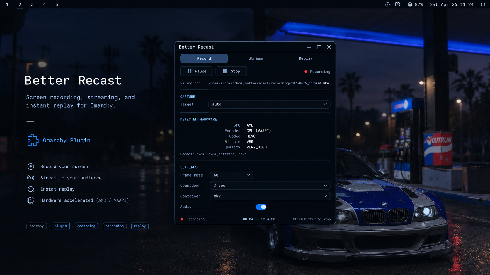

# Better Recast

GPU-accelerated screen recording, streaming, and instant replay for Omarchy/Wayland.

Uses [gpu-screen-recorder](https://git.dec05eba.com/gpu-screen-recorder/about/) to grab frames straight from the GPU framebuffer — no copy through system RAM, no CPU bottleneck. Works with NVENC (NVIDIA), VAAPI (AMD/Intel), and QuickSync. Has automatic encoder detection, per-app audio isolation, a floating control panel, pre-roll countdowns, and a 15s–20min instant replay buffer.

Integrates with [Better Bar](https://github.com/pxllbt/better-bar) too — shows a live REC/PAUSED chip in the dynamic island.



## Three modes

- **Recording** — desktop capture to MKV or MP4 with configurable bitrate, up to 240 FPS, resolution scaling, color range controls.
- **Streaming** — RTMP to Twitch, YouTube, Kick, TikTok, or custom servers. Auto picks CBR profiles per platform.
- **Instant Replay** — circular buffer (RAM or disk) of the last 15s–20min. Hit the `S` key and it saves the clip.

## Audio

- Capture specific applications, isolated from desktop sound.
- Separate mic + desktop volume sliders, auto-restored when you stop recording.
- Noise gate + filtering via FFmpeg (`afftdn`, `agate`).
- AAC, Opus, or uncompressed PCM.

## Install

Make sure you have the prerequisites:

```bash
# Arch Linux
sudo pacman -S gpu-screen-recorder python ffmpeg
```

Then install via Omarchy:

```bash
omarchy plugin add https://github.com/pxllbt/better-recast.git --enable
omarchy plugin enable pix.recast
omarchy-shell bar layout right add pix.recast
```

Open the panel: `omarchy-shell shell toggle pix.recast`

## Hotkeys

Default bindings:

```conf
# Hyprland
bind = SUPER+ALT, R, exec, ~/.local/bin/recast toggle
bind = SUPER+ALT, S, exec, ~/.local/bin/recast saveReplay
bind = SUPER+ALT, P, exec, ~/.local/bin/recast pause
bind = SUPER+ALT, O, exec, ~/.local/bin/recast openClip
```

```lua
-- Omarchy Lua
o.bind("SUPER + ALT + R", "Toggle screen recording", "~/.local/bin/recast toggle")
o.bind("SUPER + ALT + S", "Save replay clip", "~/.local/bin/recast saveReplay")
o.bind("SUPER + ALT + P", "Pause or resume recording", "~/.local/bin/recast pause")
o.bind("SUPER + ALT + O", "Open the last clip", "~/.local/bin/recast openClip")
```

CLI: `recast toggle | record | stop | pause | resume | saveReplay | openClip | openFolder | trim 00:05 00:30 [precise] | status`

## GPU support

Better Recast detects your GPU and picks the right encoder:

| GPU | Backend | Codecs |
|---|---|---|
| NVIDIA RTX | NVENC | HEVC, H.264, AV1 |
| AMD RX/RDNA | VAAPI | AV1, HEVC, H.264 |
| Intel Arc/UHD | QuickSync/VAAPI | AV1, HEVC, H.264 |
| No GPU | CPU (x264) | H.264, H.265 |

## Settings

Controlled from the panel or `~/.config/omarchy/shell.json` under `pix.recast`:

| Key | Default | What it does |
|---|---|---|
| `minFreeDiskMb` | `2000` | Won't record if free space drops below this |
| `fileNameTemplate` | `screenrecording-%Y%m%d_%H%M%S` | File name with strftime tokens |
| `container` | `mkv` | Output format — MKV survives crashes better than MP4 |
| `mode` | `record` | `record`, `stream`, or `replay` |
| `replaySeconds` | `60` | How much the replay buffer holds |
| `countdown` | `3` | Pre-roll countdown (0/3/5/10) |
| `osdEnabled` | `true` | Floating recording badge |

Full list is in `Config.js`.

## Performance

- Dormant at idle — state files are read lazily or on event, not on a poll loop.
- GPU framebuffer capture stays on the graphics card, CPU stays well under 3% during recording.
- Stream keys are passed via env vars to GSR, never show up in `/proc/<pid>/cmdline` or logs.
- Default MKV container means a crash doesn't corrupt the video.

## Dev / testing

```bash
bash tests/smoke.sh
```

## Credits

Built on [gpu-screen-recorder](https://git.dec05eba.com/gpu-screen-recorder/about/) and Quickshell. MIT licensed. By [pxllbt](https://github.com/pxllbt).